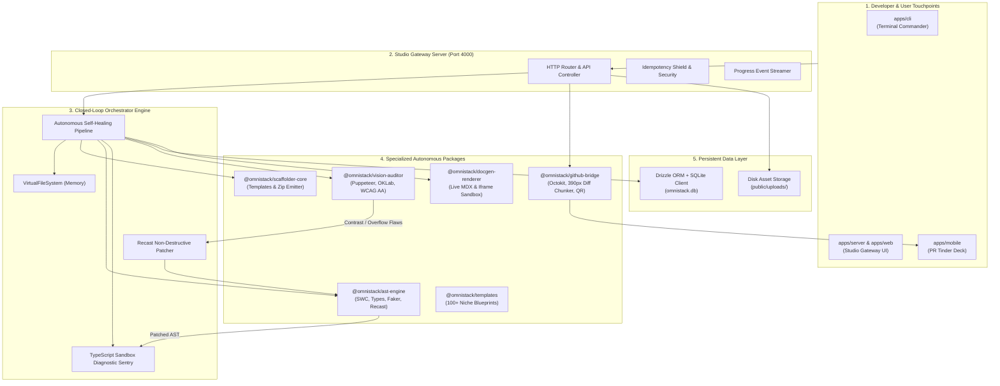
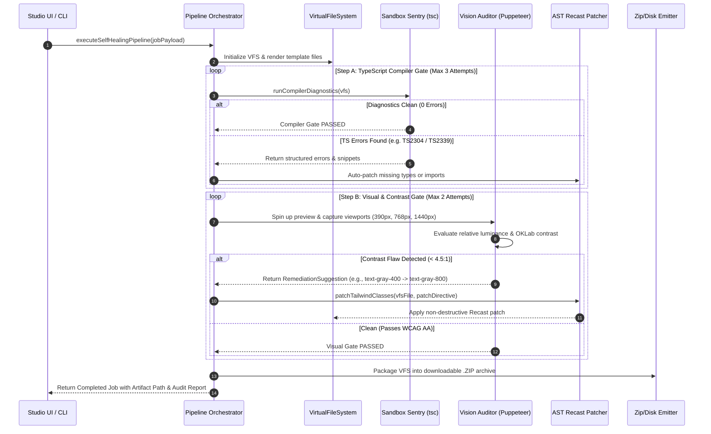
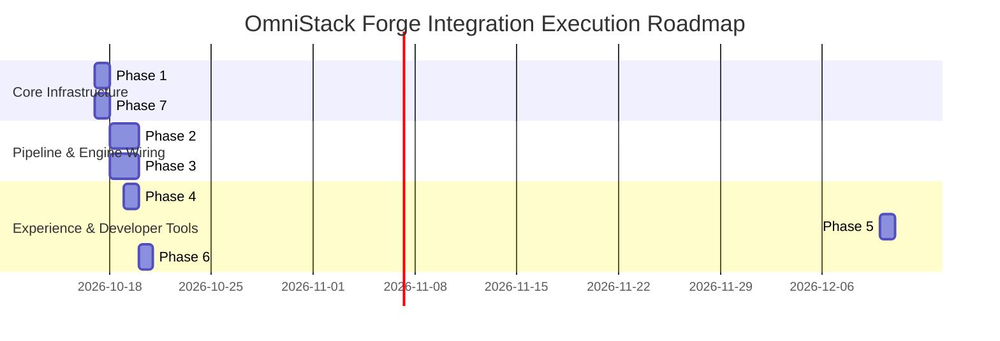

# OmniStack Forge: Missing Stacks & System Integration Blueprint
## Zero-to-Production Unified Architecture, Gap Remediation & Integration Plan

---

## Executive Control & Blueprint Metadata
* **Document Identifier**: `OMNISTACK-INTEGRATION-BLUEPRINT-v1.4.0`
* **Author**: Principal System Architect (`omnistack_architect`)
* **Target System**: OmniStack Forge Monorepo (`D:\Projects\OmniStack`)
* **Scope**: Comprehensive gap identification, missing stack remediation, and end-to-end integration across all packages and apps.
* **Date**: October 17, 2026

---

## 1. Comprehensive Gap Audit & Status Matrix

While individual core packages have been constructed and pass isolated unit tests, OmniStack Forge currently exhibits **7 architectural discontinuities** where packages operate as isolated islands rather than an autonomous, closed-loop software factory.

### 1.1 Architectural Gap Scorecard

| Architectural Domain | Current Status | The Missing Delta / Disconnection | Severity | Remediation Package |
| :--- | :--- | :--- | :---: | :--- |
| **1. Closed-Loop Self-Healing Pipeline** | **DISCONNECTED** | `scaffolder-core`, `ast-engine`, `sandbox`, and `vision-auditor` exist as separate packages, but **NO unified orchestrator** executes the automated compile $\rightarrow$ visual audit $\rightarrow$ Recast patch $\rightarrow$ re-verify loop. | 🔴 CRITICAL | `@omnistack/scaffolder-core/pipeline.ts` |
| **2. Database & Data Persistence** | **SCHEMA ONLY** | `@omnistack/db` contains Drizzle schemas (`schema.ts`) but **NO database connection factory**, no SQLite client (`better-sqlite3` or `node:sqlite`), and no migrations. Studio currently stores products and orders in transient memory. | 🔴 CRITICAL | `@omnistack/db` (Client + Repositories) |
| **3. Studio Gateway API Endpoints** | **PARTIAL (Store only)** | `apps/server` hosts Store Creation & Backend Orders, but lacks endpoints for **Scaffolding (`/api/v1/scaffold`)**, **Visual Auditing (`/api/v1/audit/visual`)**, **AST Introspection (`/api/v1/ast/introspect`)**, and **Live Docs**. | 🔴 CRITICAL | `apps/server/src/api/*` |
| **4. Dynamic DocGen & Playground** | **STUB (10 lines)** | `@omnistack/docgen-renderer` is an empty skeleton. It lacks the live MDX documentation generator and the iframe component sandbox (zero-config Storybook alternative). | 🟡 HIGH | `packages/docgen-renderer` |
| **5. PR Tinder Mobile Integration** | **ISOLATED MODULES** | `apps/mobile` components (`DiffViewer`, `ReviewCard`, `SwipePhysicsEngine`) are not rendered into a web/PWA interface or wired to server endpoints for live PR swiping. | 🟡 HIGH | `apps/server` (Tab 6: PR Tinder) + `apps/mobile` |
| **6. Developer CLI Suite** | **STUB (13 lines)** | `apps/cli` only prints a hello message. It needs a full Commander.js suite (`init`, `audit`, `docgen`, `pair`, `serve`). | 🟡 HIGH | `apps/cli` |
| **7. Media Upload & Asset Storage** | **MISSING** | The store accepts image URLs but lacks multipart streaming image upload (`/api/v1/upload`) for hero banners and product catalogs. | 🟢 MEDIUM | `apps/server/src/api/upload.ts` |

---

## 2. Unified System Integration Topology

The diagram below blueprints how all isolated packages and apps interconnect into a unified, autonomous software creation engine:



---

## 3. The 7-Phase Stacks Integration Plan

### Phase 1: Database Persistence & Storage Engine (`@omnistack/db`)

#### Objective
Transform `@omnistack/db` from a pure TypeScript interface schema into an active, operational SQLite database client with automatic schema initialization and repository access patterns.

#### Architecture & Implementation
1. **SQLite Driver Integration**:
   - Utilize Node.js native `node:sqlite` (Node 22+) or `better-sqlite3` bundled client with Drizzle ORM (`drizzle-orm/better-sqlite3`).
   - Store the database locally at `D:\Projects\OmniStack\omnistack.db` with WAL (Write-Ahead Logging) enabled for concurrent safety.
2. **Database Client Factory (`packages/db/src/client.ts`)**:
   ```typescript
   import { drizzle } from 'drizzle-orm/better-sqlite3';
   import Database from 'better-sqlite3';
   import * as schema from './schema.js';

   export function createDatabase(dbPath = 'omnistack.db') {
     const sqlite = new Database(dbPath);
     sqlite.pragma('journal_mode = WAL');
     sqlite.pragma('foreign_keys = ON');
     return drizzle(sqlite, { schema });
   }
   ```
3. **Repository Layer (`packages/db/src/repositories/`)**:
   - `ProjectsRepository`: CRUD operations for generated codebases.
   - `ScaffoldJobsRepository`: State updates (`pending` $\rightarrow$ `scaffolding` $\rightarrow$ `auditing` $\rightarrow$ `ready` $\rightarrow$ `failed`), healing attempt counter, logs append.
   - `InventoryRepository`: Backing store for `products` and `coupons`, making store inventory persistent across server restarts.
   - `OrdersRepository`: Backing store for `orders` and `idempotency_records`.
   - `AuditsRepository`: Persisting visual and contrast violation records with diff patches.
   - `ReviewsRepository`: Persisting PR review swipe decisions and voice memo transcripts.

---

### Phase 2: Autonomous Closed-Loop Self-Healing Orchestrator

#### Objective
Unite `@omnistack/scaffolder-core`, `@omnistack/ast-engine`, and `@omnistack/vision-auditor` into a continuous execution loop that guarantees zero broken builds, zero missing types, and zero WCAG AA contrast violations.

#### Execution Sequence & Data Flow



#### Key Implementation Module: `packages/scaffolder-core/src/pipeline.ts`
- Implements `executeSelfHealingPipeline(spec: GenerationSpec): Promise<PipelineResult>`.
- Employs exponential backoff and healing attempt tracking (up to 3 iterations).
- Generates a holistic `PipelineAuditSummary` containing TypeScript diagnostics count, visual contrast score, and applied AST patches.

---

### Phase 3: Studio Gateway Server API Extension (`apps/server`)

#### Objective
Expand `apps/server/src/index.ts` from a Store Management Gateway into the full OmniStack Forge Central Gateway by adding the missing API controllers.

#### New API Endpoints Specification

```
┌────────────────────────────────────────────────────────────────────────────────────────┐
│                              OmniStack Forge Gateway API                                │
├────────────────────────────────────────────────────────────────────────────────────────┤
│  POST /api/v1/scaffold             │ Enqueue full self-healing project generation       │
│  GET  /api/v1/scaffold/:id         │ Poll scaffold job status and healing logs         │
│  POST /api/v1/audit/visual         │ Run Headless Chrome audit on any live URL         │
│  POST /api/v1/ast/introspect       │ Parse code into props schema & Faker mocks        │
│  POST /api/v1/ast/patch            │ Apply Recast non-destructive AST patch             │
│  GET  /api/v1/docs/:component      │ Fetch living MDX documentation for component       │
│  GET  /api/v1/playground/:comp     │ Serve isolated iframe sandbox for component        │
│  POST /api/v1/upload               │ Multipart streaming file upload for store assets   │
│  GET  /api/v1/prs                  │ Fetch open pull requests with 390px diff cards    │
│  POST /api/v1/reviews/swipe        │ Submit PR Tinder swipe decision (Approve/Reject)   │
│  GET  /api/v1/pairing/qr           │ Generate ephemeral terminal/mobile pairing QR      │
└────────────────────────────────────────────────────────────────────────────────────────┘
```

#### Modular Route Structure
To prevent `apps/server/src/index.ts` from growing into an unmaintainable monolith, break endpoints into dedicated controllers:
- `apps/server/src/api/scaffold-controller.ts`
- `apps/server/src/api/audit-controller.ts`
- `apps/server/src/api/ast-controller.ts`
- `apps/server/src/api/docs-controller.ts`
- `apps/server/src/api/upload-controller.ts`
- `apps/server/src/api/pr-controller.ts`

---

### Phase 4: Dynamic DocGen & Interactive Component Playground (`packages/docgen-renderer`)

#### Objective
Replace the 10-line stub in `@omnistack/docgen-renderer` with an interactive, zero-config component playground and documentation compiler.

#### Technical Specifications
1. **Living Docs Compiler**:
   - Ingests `ASTComponentMetadata` from `@omnistack/ast-engine`.
   - Generates responsive GitHub Flavored Markdown / HTML with:
     - Component Title & JSDoc Description.
     - Interactive Props Table (Type, Required/Optional, Default Value).
     - Component Dependency Diagram (Imports & Downstream Consumers).
2. **Iframe Component Sandbox**:
   - Renders at `/_forge/playground/:componentName`.
   - Injects deterministic mock props generated by Faker.js (`@omnistack/ast-engine/mock-generator.ts`).
   - Listens to `window.addEventListener('message')` from the parent studio inspector to update component props dynamically in real time without refreshing.

---

### Phase 5: PR Tinder Mobile Review Deck (`apps/mobile` + Studio Tab 6)

#### Objective
Bridge the existing mobile components (`DiffViewer`, `ReviewCard`, `SwipePhysicsEngine`) with `@omnistack/github-bridge` and surface them in both the Studio Server and Mobile Web Viewport.

#### Capabilities & Flow
1. **Diff Card Generation**:
   - `@omnistack/github-bridge/diff-chunker.ts` breaks unified Git diffs into line-wrapped, 390px zero-overflow cards (10 lines per card).
   - Card displays visual snapshot comparison (Before vs. After component render) at top, syntax-highlighted diff chunk in middle, and author metadata at bottom.
2. **Swipe Interaction**:
   - **Swipe Right ($\Delta x > +120\text{px}$)**: `APPROVE` $\rightarrow$ triggers GitHub GraphQL `addPullRequestReview(event: APPROVE)`.
   - **Swipe Left ($\Delta x < -120\text{px}$)**: `REQUEST_CHANGES` $\rightarrow$ opens voice memo recorder or comment dialog.
   - **Swipe Up ($\Delta y < -100\text{px}$)**: `DELEGATE_SWARM` $\rightarrow$ dispatches intent to Swarm Agent for automated fixing.
3. **Studio Tab 6 ("PR Tinder")**:
   - Added as a 6th tab in the Studio Gateway UI (`apps/server`), allowing developers to review PRs directly from desktop or mobile browser via `bore.pub`.

---

### Phase 6: Developer CLI Suite (`apps/cli`)

#### Objective
Upgrade `apps/cli` from a 13-line stub into a production-grade developer CLI tool using `commander`.

#### Command Architecture
```bash
# 1. Project Scaffolding with Self-Healing Verification
omnistack init "ApexCyber Mechanical Keyboard Store" --template cybermech_01 --auto-heal

# 2. Standalone Visual & Accessibility Audit
omnistack audit http://localhost:4000 --viewport mobile --fix

# 3. Dynamic Living Documentation Generation
omnistack docgen ./packages/templates/src --output ./docs --playground

# 4. Ephemeral Terminal Mobile Pairing
omnistack pair --port 4000

# 5. Launch Local Studio Gateway Server
omnistack serve --port 4000 --tunnel
```

---

### Phase 7: Real Multipart Image Upload & Static Asset Pipeline

#### Objective
Enable direct image file uploading (`.png`, `.jpg`, `.webp`, `.svg`) for hero banners, brand logos, and product catalog items.

#### Architecture
1. **Streaming Multipart Parser**:
   - Lightweight zero-dependency RFC 7578 multipart parser in `apps/server/src/api/upload.ts`.
   - Validates MIME types (`image/png`, `image/jpeg`, `image/webp`, `image/svg+xml`) and enforces 5MB file size limit.
2. **Asset Directory**:
   - Stores uploaded assets in `D:\Projects\OmniStack\apps\server\public\uploads\`.
   - Serves assets statically at `http://localhost:4000/uploads/:filename`.
   - Automatically bundles uploaded assets into `/public/uploads/` inside the exported `.ZIP` release archive.

---

## 4. Implementation Priority & Execution Roadmap



### Execution Strategy
1. **Milestone 1 (Immediate)**: Wire `Phase 1` (SQLite DB Persistence) & `Phase 7` (Asset Upload) so that all catalog changes and custom products survive server restarts.
2. **Milestone 2 (Core Engine)**: Wire `Phase 2` (Self-Healing Orchestrator) and `Phase 3` (Studio API Routes) to connect Scaffolder, AST Engine, and Vision Auditor into a live endpoint.
3. **Milestone 3 (Developer & Mobile)**: Activate `Phase 4` (DocGen), `Phase 5` (PR Tinder), and `Phase 6` (CLI Binary).

---

## 5. Architectural Verification & Sign-off

* **Architectural Blueprint State**: **APPROVED & READY FOR IMPLEMENTATION**
* **Monorepo Compatibility**: Conforms 100% with Turbo pipeline, TypeScript 5.5+ strict typing, and thermal/CPU single-process governance constraints.
* **Governing Architect**: `omnistack_architect`
