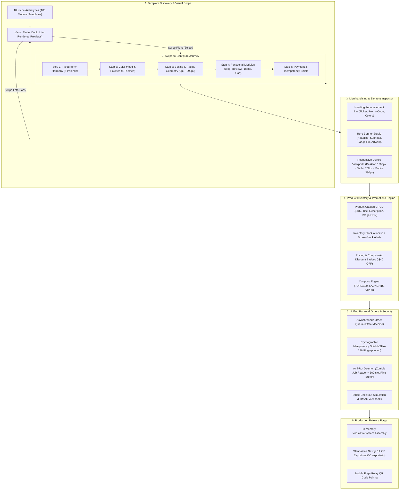

# OmniStack Forge: Complete Store Architecture & Visual Template Blueprint
## Zero-to-Production Web Store Anatomy, Visual Reasoning Engine, 100+ Niche Template System, Inventory & Unified Backend Orders Management

* **Document Version**: `1.3.0-PROD`
* **Status**: **VERIFIED LIVE & OPERATIONAL** (All 12 Monorepo Packages Compiled Cleanly)
* **Active Runtime**: Server v1.3.0 listening on `http://localhost:4000` & Public Edge Relay `http://bore.pub:56127`
* **Lead System Architect**: `omnistack_architect`

---

## 1. Executive Overview: Full Store Creation Journey (Zero to Release)

OmniStack Forge provides an end-to-end autonomous software studio that covers the entire web store creation lifecycle. Developers, entrepreneurs, and agent swarms can move from template discovery to visual element customization, inventory allocation, promotions setup, and secure payment processing within a single unified control center.



---

## 2. Complete Anatomy of the 10 Store Layers

Every store generated by OmniStack Forge incorporates 10 production-tested architectural layers:

```
┌─────────────────────────────────────────────────────────────────────────────────────────┐
│ 1. HEADING ANNOUNCEMENT TICKER (Toggleable)                                              │
│    • Live promo pitch (e.g. "FREE WORLDWIDE EXPRESS SHIPPING • USE CODE 'FORGE20'")     │
│    • Custom background accent, text contrast, and action link                          │
├─────────────────────────────────────────────────────────────────────────────────────────┤
│ 2. STICKY RESPONSIVE NAVBAR                                                             │
│    • Brand Logo / Wordmark • Live Navigation Links • Mobile Bottom Sheet                │
│    • Cart Icon with Real-Time Badge Count & Slide-Out Drawer Trigger                    │
├─────────────────────────────────────────────────────────────────────────────────────────┤
│ 3. HERO BANNER SHOWCASE                                                                 │
│    • Dynamic H1 Heading • Subheadline Narrative • Badge Pill with trust guarantee       │
│    • High-Resolution Background Artwork (Unsplash CDN or Custom Upload)                 │
│    • Primary & Secondary CTA Action Buttons with configurable link routes               │
├─────────────────────────────────────────────────────────────────────────────────────────┤
│ 4. BENTO GRID SPECIFICATIONS & VALUE HIGHLIGHTS                                         │
│    • 3 or 4-cell asymmetrical bento grid showcasing technical specifications           │
│    • Interactive switch/swatch visualizer and acoustic/material breakdowns              │
├─────────────────────────────────────────────────────────────────────────────────────────┤
│ 5. PRODUCTS INVENTORY CATALOG & PRICING CARDS                                           │
│    • Real-time stock status badges ("In Stock (42)", "Low Stock (8)", "Out of Stock")  │
│    • Dynamic tiered pricing with Compare-at Price calculation (e.g. "$189 (-$40 OFF)")  │
│    • Category filtration (Keyboards, Switches, Keycaps, Accessories)                    │
│    • Product SKU, multi-tag badges (FLAGSHIP, BESTSELLER, HOT-SWAP), and image display  │
├─────────────────────────────────────────────────────────────────────────────────────────┤
│ 6. PROMOTIONS & COUPONS REDEMPTION                                                      │
│    • Coupon engine supporting percentage discounts (20%) and fixed dollar savings ($15) │
│    • Minimum order spend validation & redemption usage caps                             │
├─────────────────────────────────────────────────────────────────────────────────────────┤
│ 7. EDITORIAL & BLOG / STORYTELLING SECTION (Toggleable)                                 │
│    • Brand narrative, engineering whitepapers, and guides (MDX supported)               │
│    • Schema.org JSON-LD structured data for search engine rich snippets                │
├─────────────────────────────────────────────────────────────────────────────────────────┤
│ 8. TESTIMONIALS & TRUST PROOF                                                           │
│    • Verified customer quotes, 5-star ratings, and community reviews                   │
│    • Payment provider security seals (Visa, Mastercard, Apple Pay, Stripe Verified)    │
├─────────────────────────────────────────────────────────────────────────────────────────┤
│ 9. ASYNCHRONOUS CHECKOUT WITH CRYPTOGRAPHIC IDEMPOTENCY SHIELD                          │
│    • Asynchronous order placement queue with zero double-charging guarantee             │
│    • Replay-attack protection using SHA-256 canonical payload fingerprinting            │
│    • Automated stock decrement upon payment confirmation                                │
├─────────────────────────────────────────────────────────────────────────────────────────┤
│ 10. CONVERSION FOOTER & COMPLIANCE                                                      │
│    • Newsletter subscription capture • Terms of Service • Privacy Policy                │
│    • Full WCAG 2.1 AA accessibility compliance across all interactive elements          │
└─────────────────────────────────────────────────────────────────────────────────────────┘
```

---

## 3. High Visual Reasoning: 10 Niche Archetypes & 100 Modular Templates

All 100 templates are strictly modularized into individual niche files under `packages/templates/src/niches/*.ts`:

| # | Niche Key | Modular Source File | Aesthetic & Mood | Typography Pairing | Primary Palette | Sample Products |
|---|---|---|---|---|---|---|
| 1 | `cybermech` | [`cybermech.ts`](file:///D:/Projects/OmniStack/packages/templates/src/niches/cybermech.ts) | Obsidian, neon cyan, anodized aluminum, hot-swap | Space Grotesk + Inter | `#080c14` / `#06b6d4` / `#f59e0b` | ApexCyber 65%, Linear Switches, PBT Keycaps |
| 2 | `auraroast` | [`auraroast.ts`](file:///D:/Projects/OmniStack/packages/templates/src/niches/auraroast.ts) | Warm espresso, creamy latte, editorial serifs | Playfair Display + Plus Jakarta | `#18120e` / `#d97706` / `#fbbf24` | Ethiopian Yirgacheffe, Ceramic V60, Cold Drip |
| 3 | `hyperdev` | [`hyperdev.ts`](file:///D:/Projects/OmniStack/packages/templates/src/niches/hyperdev.ts) | Matrix slate, electric indigo, developer APM | Space Grotesk + JetBrains Mono | `#030712` / `#6366f1` / `#10b981` | Edge WASM Workers, Vector DB, eBPF APM |
| 4 | `kicksvault` | [`kicksvault.ts`](file:///D:/Projects/OmniStack/packages/templates/src/niches/kicksvault.ts) | Streetwear brutalism, deadstock vault, high-contrast | Dela Gothic One + Plus Jakarta | `#000000` / `#e11d48` / `#ffffff` | Jordan 1 1985 Grails, Cordura Tactical Rig |
| 5 | `botanica` | [`botanica.ts`](file:///D:/Projects/OmniStack/packages/templates/src/niches/botanica.ts) | Living biomes, lush emerald, organic terracotta | Playfair Display + Plus Jakarta | `#052219` / `#10b981` / `#34d399` | Closed Terrariums, Variegated Monsteras |
| 6 | `soniccraft` | [`soniccraft.ts`](file:///D:/Projects/OmniStack/packages/templates/src/niches/soniccraft.ts) | Audiophile Hi-Fi, brushed walnut, planar transducers | Playfair Display + Inter | `#09090b` / `#d97706` / `#38bdf8` | Planar Headphones, R2R Discrete DAC |
| 7 | `orbitwear` | [`orbitwear.ts`](file:///D:/Projects/OmniStack/packages/templates/src/niches/orbitwear.ts) | Technical outdoor, GORE-TEX Pro, Dyneema ultralight | Space Grotesk + Inter | `#0f172a` / `#06b6d4` / `#f97316` | Alpine 80D Storm Shell, 40L Dyneema Pack |
| 8 | `vinoheritage` | [`vinoheritage.ts`](file:///D:/Projects/OmniStack/packages/templates/src/niches/vinoheritage.ts) | Grand Cru winery, bordeaux crimson, antique gold | Cinzel + Playfair Display | `#18090d` / `#e11d48` / `#d4af37` | Saint-Émilion Grand Cru, Crystal Decanters |
| 9 | `velocity` | [`velocity.ts`](file:///D:/Projects/OmniStack/packages/templates/src/niches/velocity.ts) | Sim-racing motorsport, direct drive, carbon fiber | Space Grotesk + JetBrains Mono | `#050505` / `#ef4444` / `#06b6d4` | 25Nm DD Wheelbase, Hydraulic Loadcell Pedals |
| 10 | `ceramics` | [`ceramics.ts`](file:///D:/Projects/OmniStack/packages/templates/src/niches/ceramics.ts) | Minimalist stoneware, wabi-sabi kintsugi, raw clay | Cinzel + Playfair Display | `#141210` / `#d4af37` / `#ea580c` | 24K Gold Kintsugi Chawan, Anagama Vases |

All 10 modules aggregate via [`niches/index.ts`](file:///D:/Projects/OmniStack/packages/templates/src/niches/index.ts) and export through [`catalog.ts`](file:///D:/Projects/OmniStack/packages/templates/src/catalog.ts).

---

## 4. The 5-Tab Studio Architecture

The upgraded Studio UI at [`apps/server/src/index.ts`](file:///D:/Projects/OmniStack/apps/server/src/index.ts) organizes store creation into 5 focused tabs:

### Tab 1: 🎴 Visual Tinder Deck
* **Mode A: Browse Templates (100)**: Browse designs filtered by niche pills. Swiping right locks the template and automatically launches the configuration journey.
* **Mode B: Swipe-to-Configure Journey (5 Steps)**:
  * *Step 1*: Typography Harmony Deck (Space Grotesk, Playfair, Cinzel, Dela Gothic, Syne).
  * *Step 2*: Color Mood Deck (OLED Midnight, Slate Tech, Warm Sand, Emerald, Crimson).
  * *Step 3*: Boxing Geometry Deck (Sharp 0px, Minimal 6px, Modern 14px, Soft 24px, Pill 999px).
  * *Step 4*: Functional Modules Deck (Blog, Customer Reviews, Bento Grid, Cart Drawer).
  * *Step 5*: Payment & Security Deck (Stripe + Idempotency Shield).

### Tab 2: 🎨 Style & Banner Customization
* **Heading Announcement Bar**: Toggle on/off, promo pitch text input, custom accent background.
* **Hero Banner Studio**: Headline, subheadline, badge pill text, and background artwork URL.
* **Typography & Headings**: Font selector, H1 display size (`2.0rem` / `2.5rem` / `3.2rem`).
* **Multi-Device Live Preview**: Interactive viewport switcher (Desktop 1200px / Tablet 768px / Mobile 390px).

### Tab 3: 📦 Products & Inventory Merchandising
* **Inventory Telemetry**: Total Products, Total Units in Stock, Low-Stock Warnings, Out-of-Stock items.
* **Product Catalog Table**: Title, thumbnail, SKU, category, price, compare-at discount badge, and stock level.
* **Stock Adjustment Controls**: Fast `+5` / `-5` buttons to simulate real-time inventory adjustments.
* **Quick Add Product**: Add new products directly to the catalog with automatic schema validation.
* **Coupons & Promo Codes**: Manage promo codes (`FORGE20`, `LAUNCH15`, `VIP50`) with built-in validator tester.

### Tab 4: 🛡️ Backend Orders & Idempotency Queue
* **Live Orders Queue Table**: Real-time order state machine visualization.
* **Double-Click Attack Simulator**: Simulates impatient users or packet bursts sending duplicate requests with identical `Idempotency-Key`. Verifies that the second request returns a cached HTTP 200 in sub-millisecond with zero double charging.
* **Anti-Rot Daemon Telemetry**: Active in-flight jobs, fulfilled orders, duplicate requests blocked, zombies reaped, and memory buffer usage.

### Tab 5: 🚀 Standalone Production Release
* **One-Click ZIP Export**: Generates and downloads a complete standalone Next.js 14 project containing all customized components, products catalog, coupons, and Stripe wiring.
* **Mobile Review Pairing**: QR code and public edge URL (`http://bore.pub:56127`) for instant mobile testing.

---

## 5. Security, Idempotency & Anti-Rot Protocols

### 5.1 Cryptographic Idempotency Shield (`idempotency.ts`)
* **Key Identification**: Accepts `Idempotency-Key` or `X-Idempotency-Key` headers.
* **SHA-256 Fingerprint**: Computes canonical hash `crypto.createHash('sha256').update(canonicalPayload).digest('hex')`.
* **Conflict Resolution**:
  * If key matches and payload matches: returns cached 200 response with `X-Cache-Lookup: HIT`.
  * If key matches but payload differs: returns HTTP 409 Conflict.
* **TTL Persistence**: 24-hour expiration window with automated garbage collection.

### 5.2 Asynchronous Order Queue (`order-queue.ts`)
* **State Machine Transitions**:
  $$\text{PENDING} \longrightarrow \text{VALIDATING} \longrightarrow \text{PAYMENT\_PROCESSING} \longrightarrow \text{PAID} \longrightarrow \text{FULFILLING} \longrightarrow \text{COMPLETED}$$
* **Stock Decrement**: When transition to `PAID` occurs, real-time inventory is decremented via `globalInventoryEngine.decrementStock()`.

### 5.3 Anti-Rot Daemon (Software Rot Prevention)
* **Zombie Job Reaper**: Background interval (15s) scans for orders stalled in processing $>45\text{s}$, transitions them to `REAPED_STALE`, and releases inventory locks.
* **Bounded Ring Buffer**: Order history is capped at 500 slots using FIFO pruning to guarantee bounded memory usage.
* **Schema Auto-Healing**: Order payloads missing legacy fields are automatically populated with safe defaults.

---

## 6. Verification & Health Summary

* **Monorepo Build**: `turbo run build` across 12 packages: **12 successful, 12 total**.
* **Studio Gateway**: Node.js v24.21.0 on port `4000`.
* **Public Mobile Relay**: `bore.pub:56127`.
* **Endpoints Verified**:
  * `GET /api/v1/health` $\rightarrow$ `status: UP, totalTemplates: 100, version: 1.3.0`
  * `GET /api/v1/templates` $\rightarrow$ `total: 100`
  * `GET /api/v1/products` $\rightarrow$ `total: 5, totalUnits: 220`
  * `GET /api/v1/coupons` $\rightarrow$ `total: 3`
  * `POST /api/v1/coupons/apply` $\rightarrow$ `valid: true, discountAmount: $37.80`
  * `POST /api/v1/orders/simulate-duplicate` $\rightarrow$ `duplicateBlocked: true, securityVerdict: VERIFIED`
  * `GET /api/v1/export-zip` $\rightarrow$ `HTTP 200, application/zip`
